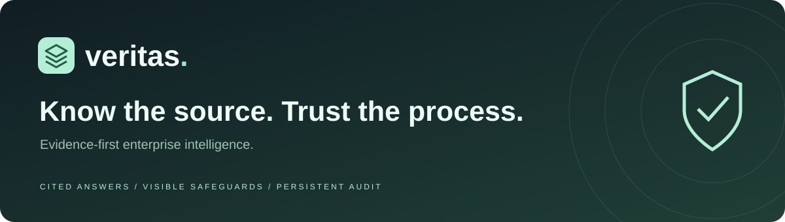
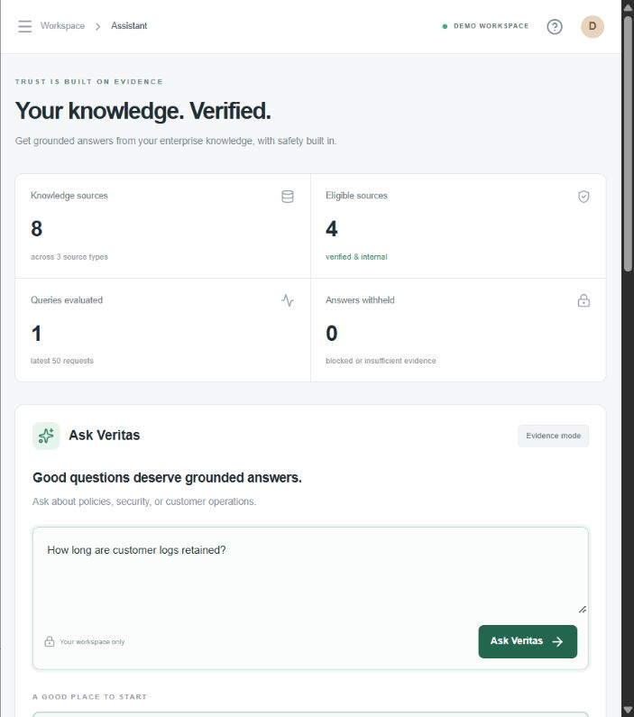

<div align="center">



# Veritas

### Evidence-first enterprise intelligence

[](https://github.com/kdivyam07/veritas/actions/workflows/ci.yml)


**[Open the live website](https://veritas-by-divyam.vercel.app/)** · [Documentation index](docs/index.md) · [Hosting guide](HOSTING.md)

</div>

## Contents

- [The problem](#the-problem)
- [What works](#what-works)
- [Technology](#technology)
- [Run locally](#run-locally)
- [Deploy](#deploy)
- [Demo walkthrough](#demo-walkthrough)
- [Project index](#project-index)
- [Checks](#checks)
- [Scope and limitations](#scope-and-limitations)

## The problem

Enterprise assistants pull from messy internal wikis, SQL data and unverified APIs. Sources can disagree, be stale, or include restricted records. Veritas makes evidence, retrieval boundaries and refusals visible in a full-stack workspace.

## What works

| Feature               | Behavior                                                                             |
| --------------------- | ------------------------------------------------------------------------------------ |
| Evidence assistant    | Exact matching excerpts with inspectable source citations                            |
| Source library        | Import Wiki/SQL/API text snapshots, review them, search, filter and toggle retrieval |
| Server safeguards     | Access, trust, freshness, known injection patterns and selected output redaction     |
| Refusals              | Explicit blocked, insufficient-evidence and conflict-review states                   |
| Persistent audit      | Database-backed query decisions with JSON export                                     |
| Guest workspaces      | Opaque HttpOnly cookie sessions, with server-scoped source and audit records         |
| Responsive navigation | Independently scrolling sidebar, mobile close controls and keyboard handling         |
| Session protection    | Confirmation before ending a guest session and losing access to its workspace        |



The public website opens without an OpenAI login. Each browser receives an isolated guest workspace. It is a demo session, not an enterprise account or SSO identity.

## Technology

- Next.js App Router, React, TypeScript and Lucide icons.
- Vercel Node.js functions and Neon PostgreSQL.
- Drizzle queries and explicit SQL schema initialization.
- Local PGlite for PostgreSQL-compatible development without a hosted database.
- Node test runner, TypeScript, Prettier and GitHub Actions.

The repository root is the deployable source. It no longer depends on Cloudflare D1 or ChatGPT Sites. No generative model or AI API key is required: answers are **extractive evidence excerpts**.

## Run locally

Use **Node 22.x, version 22.18 or later**, npm and Git.

```sh
git clone https://github.com/kdivyam07/veritas.git
cd veritas
npm ci
npm run db:local
npm run dev
```

Open the loopback URL printed by Next.js, normally http://127.0.0.1:3000. A guest workspace initializes automatically with eight synthetic sources. Local data is stored in `.data/veritas` unless `DATABASE_URL` is configured privately in `.env.local`.

## Deploy

Read [HOSTING.md](HOSTING.md). Connect a Neon database and set `DATABASE_URL` in Vercel. The build command is:

```sh
npm run db:migrate && npm run build
```

The existing project serves **https://veritas-by-divyam.vercel.app/**. GitHub pushes to `main` should use that same source and production project. Vercel's deployment check is distinct from the GitHub Actions verification job; both should be checked before reporting a successful release.

## Demo walkthrough

1. Ask **How long are customer logs retained?** Inspect the 90-day policy citation. The stale 365-day policy and unverified API claim are excluded.
2. Ask **How is customer data encrypted?** Inspect the security handbook.
3. Ask **What is the Enterprise uptime SLA?** Inspect the SQL snapshot.
4. Ask for employee salaries. The request is blocked and its text is withheld from stored query history.
5. Ask an unsupported question. The app withholds an answer.
6. Import a synthetic policy, review it, ask a matching question, then disable it and repeat.
7. Open the audit trail and export its returned history.

## Project index

```text
app/
  api/workspace/route.ts   Source and query API
  api/session/route.ts     End a guest session
  api/health/route.ts      Database availability check
  dashboard.tsx           Interactive workspace
  veritas.css             Responsive design
lib/
  engine.ts               Evidence policy, matching, redaction and fixtures
  session.ts              Database-backed opaque guest sessions
  request-body.ts         Bounded JSON request parsing
  request-origin.ts       Same-origin write checks
db/                       PostgreSQL schema and database client
migrations/postgres/      Idempotent SQL schema files
scripts/                  Schema initialization and API test runner
tests/                    Engine, request and API regression checks
docs/                     Indexed project guides
.github/                  CI and issue/PR templates
```

## Checks

```sh
npm test
npm run typecheck
npm run format:check
npm run build
npm run db:local
npm run test:integration
npm audit --omit=dev
```

There are **23 unit behavior cases** plus an authenticated API integration suite. Tests cover evidence filtering, refusal/redaction, request byte limits, invalid JSON, origin checks, session isolation, source review, persistence and session revocation. Browser checks cover navigation, scroll bounds and the primary user flows.

## Scope and limitations

This is a Prompt Wars hackathon prototype using synthetic data. SQL/API imports are snapshots, not live connectors. Retrieval is lexical, source claims can be wrong, and human review does not prove truth. Injection and PII checks use limited patterns; conflict detection is a numeric heuristic.

Guest sessions expire after 30 days. Ending a session or clearing its cookie has no recovery flow; old data is not automatically deleted. There is no enterprise SSO, rate limiter or complete retention system. Use synthetic or public content only. Read [SECURITY.md](SECURITY.md) and the [threat model](docs/threat-model.md).

Built by **[Divyam Kumar / kdivyam07](https://github.com/kdivyam07)** with AI-assisted implementation. See [contributing](CONTRIBUTING.md), [roadmap](docs/roadmap.md) and the [demo pitch](docs/launch.md).
