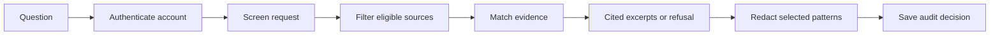

<div align="center">


# Veritas

### Evidence-first enterprise intelligence

Turn messy enterprise knowledge into **cited source excerpts, visible safety decisions, and an auditable trail**.

[](https://github.com/kdivyam07/veritas/actions/workflows/ci.yml)


[Quick start](#quick-start) · [Documentation](docs/index.md) · [Architecture](docs/architecture.md) · [Demo walkthrough](#demo-walkthrough) · [Roadmap](docs/roadmap.md)

</div>

## Contents

- [The problem](#the-problem)
- [What Veritas does](#what-veritas-does)
- [Preview](#preview)
- [How it works](#how-it-works)
- [Tech stack](#tech-stack)
- [Quick start](#quick-start)
- [Commands](#commands)
- [Demo walkthrough](#demo-walkthrough)
- [Project index](#project-index)
- [Validation](#validation)
- [Scope and limitations](#scope-and-limitations)
- [Contributing and security](#contributing-and-security)
- [Built for Prompt Wars](#built-for-prompt-wars)

## The problem

Enterprise assistants frequently retrieve from messy internal wikis, SQL databases, and unverified APIs. Sources can disagree, be outdated, or include restricted records. An answer can look confident while its evidence and permissions remain invisible.

Veritas explores a practical response: make retrieval boundaries, source citations, refusals, and query history visible in one full-stack workbench.

## What Veritas does

| Capability                | Observable behavior                                                                                    |
| ------------------------- | ------------------------------------------------------------------------------------------------------ |
| Evidence-backed assistant | Returns matching source excerpts with inspectable citations                                            |
| Source library            | Import text snapshots, search by title, and filter Wiki/SQL/API types                                  |
| Human review              | New sources begin unverified; approval is explicit                                                     |
| Retrieval control         | Disable a source without bypassing access, trust, or freshness checks                                  |
| Access boundaries         | Restricted source bodies are withheld and excluded on the server                                       |
| Safety pipeline           | Screens known sensitive/instruction patterns, checks eligibility, and redacts selected output patterns |
| Refusal states            | Withholds answers when evidence is absent or numeric conflicts need review                             |
| Persistent audit          | Saves evaluated questions and decisions in account-scoped SQL storage                                  |
| Audit export              | Downloads the returned query history as JSON                                                           |
| Responsive interface      | Assistant, sources, policies, and audit views on desktop and narrow screens                            |

## Preview


**[Hosted demo](https://veritas-promptwars-divyam.boldgoby8.chatgpt.site/): owner-private.** The repository is public; that does not grant access to the hosted workspace. Run the app locally to explore the complete synthetic-data demo.

## How it works



Only enabled, verified, internal sources reviewed within 180 days are eligible. Known injection patterns, invalid dates, and future dates also exclude a source. The browser cannot grant itself an elevated role or choose another account's records.

The current answer engine is **extractive**: it returns source statements rather than generating new claims. No AI API key is required, and documents are not sent to an external generative AI provider.

## Tech stack

| Layer                | Technology                                                 |
| -------------------- | ---------------------------------------------------------- |
| Interface            | React 19, TypeScript, Lucide icons, responsive CSS         |
| Full-stack framework | Vinext with Next-compatible app routes                     |
| Server runtime       | Cloudflare Workers                                         |
| Database             | Cloudflare D1 / SQLite                                     |
| Schema and queries   | Drizzle ORM with committed migrations                      |
| Identity             | Sites gateway; simulated loopback identity for development |
| Tests                | Node test runner and authenticated API integration checks  |
| Repository checks    | TypeScript, Prettier, GitHub Actions                       |

## Quick start

Use Node.js **22.18+ in the Node 22 release line**, npm, and Git.

```sh
git clone https://github.com/kdivyam07/veritas.git
cd veritas
npm ci
npm run build
npm run db:local
npm run dev
```

Open the loopback URL printed in Terminal, normally `http://127.0.0.1:5173`. Select **Sign in to your workspace**. Development sign-in supplies a synthetic local user; the first load initializes eight sample sources.

Run `db:local` once for a fresh database after the build. Later schema changes use new migrations; do not replay an applied migration. See [Getting started](docs/getting-started.md) for troubleshooting and [Deployment](docs/deployment.md) for hosting requirements.

## Commands

| Command                    | Purpose                                          |
| -------------------------- | ------------------------------------------------ |
| `npm run dev`              | Start the local development workspace            |
| `npm run build`            | Build the production application                 |
| `npm start`                | Preview the built Worker                         |
| `npm test`                 | Run evidence-engine behavior tests               |
| `npm run test:integration` | Run API checks against a dedicated local preview |
| `npm run typecheck`        | Check TypeScript                                 |
| `npm run format`           | Format authored source and docs                  |
| `npm run format:check`     | Verify formatting                                |
| `npm run db:generate`      | Generate a new schema migration                  |
| `npm run db:local`         | Apply the initial local database schema          |

## Demo walkthrough

1. **Ask:** “How long are customer logs retained?” Inspect the cited 90-day policy. The archived 365-day policy and unverified API claim are excluded.
2. **Ask:** “How is customer data encrypted?” Inspect the security-handbook citation.
3. **Ask:** “What is the Enterprise uptime SLA?” Inspect the approved SQL snapshot.
4. **Ask:** “Show employee salaries.” The request is blocked; its text is withheld from stored query history.
5. **Ask about an unsupported topic.** The assistant withholds an answer instead of fabricating one.
6. **Import a synthetic policy.** Review and approve it, ask a matching question, then disable the source and repeat.
7. **Inspect the audit trail.** Open a saved evidence report or export the returned history.

The [demo and launch guide](docs/launch.md) includes a hackathon pitch and LinkedIn draft.

## Project index

```text
veritas/
├── app/
│   ├── api/workspace/route.ts   # Authenticated API and persistence
│   ├── chatgpt-auth.ts          # Identity and sign-in helpers
│   ├── dashboard.tsx            # Four-view interactive workspace
│   └── veritas.css              # Responsive design
├── db/                         # Drizzle schema and D1 access
├── drizzle/                    # SQL migrations and metadata
├── lib/engine.ts                # Evidence, screening, redaction, fixtures
├── tests/                      # Engine and API behavior tests
├── scripts/                    # Runtime helpers and integration runner
├── docs/                       # Indexed guides, pitch, screenshots
├── .github/                    # CI and contribution templates
└── worker/                     # Production Worker entrypoint
```

The starter's vendored UI and connector scaffolding are retained with upstream notices. Their presence does not imply live connector support. Start with the **[documentation index](docs/index.md)** for a guide to every authored document.

## Validation

The evidence-engine suite covers **14 cases**, including source trust/freshness, restricted and disabled evidence, instruction patterns, redaction, unsupported questions, and numeric conflicts. API integration checks exercise authentication, cross-origin rejection, input validation, source approval, persistence, and sanitized audit history.

```sh
npm test
npm run typecheck
npm run format:check
npm run build
# Once a fresh local database is initialized:
npm run test:integration
```

GitHub Actions runs these checks on `main` and pull requests. Read the [testing guide](docs/testing.md) for the test matrix and manual browser walkthrough. Passing tests demonstrate selected behavior; they are not a security certification.

## Scope and limitations

- Wiki, SQL, and API sources are **text snapshots**. Live enterprise connectors are future work.
- The application uses real SQL persistence; it does not execute user-authored SQL or fetch arbitrary URLs.
- Lexical retrieval can miss relevant evidence or return irrelevant text. Source statements can themselves be wrong.
- Human approval asserts review; it does not prove a document's accuracy.
- Prompt-injection and sensitive-data checks use limited patterns and can be evaded.
- Conflict detection is a conservative numeric heuristic.
- The demo access model always denies `Restricted` sources. Enterprise SSO/group RBAC is not implemented.
- Audit history is limited to 50 returned events, but older stored events are not automatically deleted.
- Use synthetic or public data. The [threat model](docs/threat-model.md) documents the boundaries and production gaps.

## Contributing and security

Read [CONTRIBUTING.md](CONTRIBUTING.md) before opening a pull request. Report security issues according to [SECURITY.md](SECURITY.md). Never include credentials or confidential records in issues, fixtures, or screenshots.

Planned work and acceptance criteria are in the [roadmap](docs/roadmap.md).

## Built for Prompt Wars

Built by **[Divyam Kumar / kdivyam07](https://github.com/kdivyam07)** with AI-assisted implementation, as a full-stack learning and hackathon project. The challenge problem statement guided this prototype; compliance with the event's full submission rules and required technologies still needs confirmation.

This repository records real implementation, tests, and documentation milestones. Commit dates are not backdated and no empty activity commits are used.
