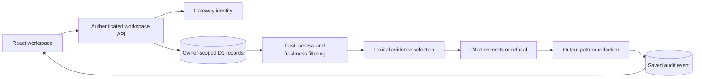

# Architecture

[Documentation index](index.md)

## Request flow

The browser submits a question. The API obtains the account identity from the hosting gateway, reads only that account's documents, and evaluates the question. Sources must be enabled, internal, verified, recently reviewed, and free of known injection patterns. The engine selects matching excerpts or withholds the answer. The API persists the decision before returning it.

## Source eligibility

The source date must parse successfully, be no later than the evaluation time, and be less than 180 days old. Source status and access are controlled on the server; posted role or owner fields do not grant access. New imports are unverified, unless known instruction patterns cause immediate quarantine. Human approval records review; it does not independently validate facts.

## Database model

| Table       | Key                     | Stored records                                                                   |
| ----------- | ----------------------- | -------------------------------------------------------------------------------- |
| `documents` | Composite `(id, owner)` | Title, kind, raw snapshot, trust status, access label, review date, enabled flag |
| `events`    | UUID `id`               | Owner, sanitized question, outcome, serialized evidence report, timestamp        |

Query history returns the latest 50 events, but older events remain in the database. A retention/deletion feature is future work. Blocked sensitive requests store `[Sensitive request withheld]` instead of the original question.

## Code index

| Location                            | Responsibility                                                             |
| ----------------------------------- | -------------------------------------------------------------------------- |
| `app/dashboard.tsx`                 | Assistant, sources, policies, audit, and dialogs                           |
| `app/veritas.css`                   | Responsive visual styling                                                  |
| `app/api/workspace/route.ts`        | Authenticated API, input checks, and persistence                           |
| `app/chatgpt-auth.ts`               | Gateway identity and sign-in helpers                                       |
| `lib/engine.ts`                     | Source fixtures, screening, redaction, eligibility, ranking, and decisions |
| `db/schema.ts`                      | Drizzle table definitions                                                  |
| `drizzle/`                          | Versioned SQL migration and schema metadata                                |
| `worker/index.ts`, `vite.config.ts` | Worker routing and runtime bindings                                        |
| `tests/`                            | Engine and API behavior checks                                             |

## Deliberate limits

The engine is lexical and extractive. It does not synthesize new facts, execute user SQL, fetch arbitrary URLs, or call a generative model. The SQL/API labels describe imported text snapshots. The underlying application database is real SQL storage.

The platform starter includes unused UI components and connector scaffolding. They are retained with upstream notices; they are not evidence of live external integrations.
