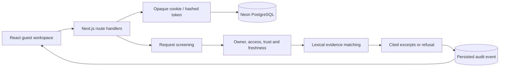

# Architecture

[Documentation index](index.md)

The repository root is the production source. Next.js runs on Vercel Node.js functions. Drizzle uses Neon HTTP in production; local development uses PGlite against the same PostgreSQL schema.

## Data

| Table       | Purpose                                                                    |
| ----------- | -------------------------------------------------------------------------- |
| `documents` | Owner-scoped source snapshots; composite `(id, owner)` key and owner index |
| `events`    | Owner-scoped question decisions and evidence reports                       |
| `sessions`  | SHA-256 token hash, generated owner ID and expiry                          |

The first workspace load establishes a guest cookie and inserts missing synthetic fixtures. Guest tokens expire after 30 days. GET returns sanitized source bodies, the server-computed eligible count, and the latest 50 audit events. Older records are not automatically deleted.

POST requests need an existing valid session and matching origin. Requests blocked by screening do not retrieve source content. Other questions only use enabled, internal, verified sources with valid review dates less than 180 days old. Future dates and known injection patterns exclude a source. Matching excerpts are returned with citations; absent evidence or detected numeric conflicts cause refusal.

The engine is extractive, not generative. It neither executes user SQL nor fetches arbitrary URLs. Source type labels describe text snapshots, not active enterprise connectors.

## Interface reliability

- A new question clears the previous evidence report before submission.
- An unavailable initial workspace has an explicit retry state.
- The sidebar scrolls independently at short heights. The mobile drawer has close controls, a backdrop, Escape handling and keyboard containment.
- A hidden mobile menu is inert. Session reset is confirmed before access is revoked.
- Safety pipeline states distinguish skipped checks from passed checks.
